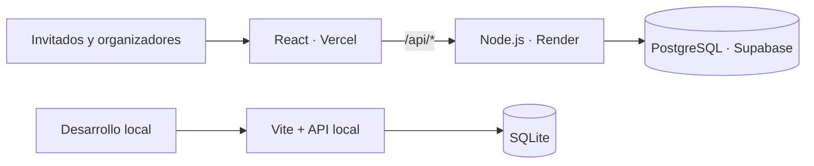

# Invitación de boda · Lucas & Coty

Invitación digital para una boda, con diseño editorial inspirado en papelería botánica. El proyecto combina una experiencia pública para los invitados con un panel privado para administrar confirmaciones y pagos.

**Ver invitación:** [invitacion-coty-luqi.vercel.app](https://invitacion-coty-luqi.vercel.app)

## Funcionalidades

- Diseño adaptable a celular y escritorio, con navegación por secciones.
- Detalles del evento, ubicación con opciones de Google Maps y Apple Maps, código de vestimenta y cuenta regresiva.
- Formulario de asistencia con hasta dos acompañantes y comentarios sobre alergias o necesidades alimentarias.
- Página de confirmación con mensajes de éxito, error y estado de envío.
- Panel privado para buscar y filtrar respuestas, administrar invitados y acompañantes, y registrar pagos parciales o completos.
- Resumen de asistentes y recaudación, contemplando invitaciones sin cargo.
- Validación de datos en el servidor y Row Level Security (RLS) habilitado en las tablas de Supabase.

## Tecnologías

| Área | Tecnología |
| --- | --- |
| Interfaz | React, Vite, JavaScript y CSS |
| API | Node.js y HTTP |
| Persistencia local | SQLite |
| Base de datos publicada | PostgreSQL en Supabase |
| Hosting del frontend | Vercel |
| Hosting de la API | Render |

## Arquitectura



En producción, Vercel reenvía las rutas `/api/*` a Render. El backend valida los datos y administra el acceso al panel; las confirmaciones, acompañantes y pagos se guardan en Supabase. En desarrollo local, la API integrada con Vite usa SQLite si no se configura `DATABASE_URL`.

## Ejecutar localmente

Requisitos: Node.js 24 o posterior y npm.

1. Cloná el repositorio e instalá las dependencias:

   ```bash
   git clone https://github.com/Luqui27/InvitacionCotyLuqi.git
   cd InvitacionCotyLuqi
   npm ci
   ```

2. Creá `.env.local` a partir del archivo de ejemplo:

   **PowerShell**

   ```powershell
   Copy-Item .env.example .env.local
   ```

   **macOS / Linux**

   ```bash
   cp .env.example .env.local
   ```

3. Definí `ADMIN_PASSWORD` en `.env.local`. Para trabajar localmente podés dejar `DATABASE_URL` vacío; se creará una base SQLite local en `data/invitacion.sqlite`.

4. Iniciá la aplicación:

   ```bash
   npm run dev
   ```

   Abrí la dirección local que muestra Vite. El panel de administración está disponible en `/admin`.

## Despliegue

La configuración del proyecto está preparada para Vercel, Render y Supabase:

- **Vercel:** publica la aplicación React y reescribe `/api/*` hacia Render. La configuración de rutas está en [`vercel.json`](vercel.json).
- **Render:** ejecuta la API con `npm start`. Configurá `npm ci` como comando de compilación y `/api/health` como ruta de verificación.
- **Supabase:** aloja PostgreSQL. El backend crea y actualiza el esquema al iniciar; la definición está en [`server/schema.sql`](server/schema.sql).

Variables privadas requeridas en Render:

| Variable | Uso |
| --- | --- |
| `ADMIN_PASSWORD` | Contraseña del panel privado |
| `DATABASE_URL` | URI de conexión PostgreSQL de Supabase |
| `SUPABASE_CA_CERT` | Certificado raíz para validar la conexión TLS |
| `FRONTEND_ORIGINS` | Origen u orígenes permitidos del frontend, separados por comas |

No subas `.env.local`, contraseñas, cadenas de conexión ni certificados privados al repositorio. Los valores locales y de producción se configuran fuera de Git.

## Estructura del proyecto

```text
src/             Interfaz, estilos y panel de administración
server/          API, validación, autenticación y persistencia
public/florals/  Recursos visuales de la invitación
vercel.json      Reescrituras para la SPA y la API
```

## Comandos útiles

```bash
npm run dev      # aplicación local
npm run build    # compilación de producción
npm run preview  # vista previa de la compilación
npm run lint     # análisis estático del código
```
